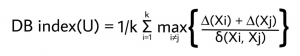
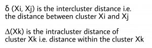

Gridsearch
##############

For the detection of the optimal number of clusters, the python library ``clusteval`` is utilized to evaluate the **goodness** of clusters.
The clustering approaches can be set to *agglomerative*, *kmeans*, *dbscan* and *hdbscan*, for which the ``clusteval`` library then searches across the space of clusters and method-parameters to determine the optimal number of clusters given the input audio dataset.

**Cluster evaluation can be performed based on:**

    * Silhouette scores
    * DBindex
    * Derivative method

Let's load an audio dataset and see how the different methods detect the optimal number of clusters.

.. code:: python

    from clustaudio import clustaudio
    
    # Initialize with MFCC features
    cl = clustaudio(method='mfcc', sr=22050)
    
    # Load audio files
    pathnames = cl.import_example(data='music')
    
    # Or use your own audio collection
    # pathnames = '/path/to/audio/files/'

Silhouette
##############

The silhouette value is a measure of how similar a sample is to its own cluster (cohesion) compared to other clusters (separation).
The scores range between [−1, 1], where a high value indicates that the audio file is well matched to its own cluster and poorly matched to neighboring clusters.
The silhouette approach is thus a sample-wise approach, which means that for each audio file, a silhouette score is computed and if most samples have a high value, then the clustering configuration is appropriate.
If many points have a low or negative value, then the clustering configuration may have too many or too few clusters.
The silhouette can be calculated with any distance metric, such as the Euclidean distance or the Manhattan distance.

.. code:: python

    # Feature extraction and cluster evaluation
    results = cl.fit_transform(pathnames, evaluate='silhouette', cluster='agglomerative')
    
    # Or cluster using different (evaluation) method after initial fit
    # labels = cl.cluster(evaluate='silhouette', cluster='agglomerative', cluster_space='high')
    
    # Plot the cluster evaluation
    cl.clusteval.plot()
    
    # Scatter plot (will show waveforms if zoomed)
    cl.scatter(zoom=3)
    
    # Dendrogram
    cl.dendrogram()

.. |figCE0| image:: ../figs/audio_clusters.png
.. |figCE6| image:: ../figs/silhouette_tsne_audio.png

.. table:: Left: The number of clusters vs silhouette scores. Right: tSNE plot coloured on the cluster-labels for audio files.
   :align: center

   +----------+----------+
   | |figCE0| | |figCE6| |
   +----------+----------+

The silhouette plot shows the optimal number of clusters for the given audio data. The best cluster count is where the majority of clusters are above the average silhouette scores and does not widely fluctuate in the size of the silhouette plots. 
Note that the cluster evaluation is performed on the high-dimensional feature space (MFCC or spectral features). For illustration purposes, the 2D t-SNE space is shown and coloured on the detected cluster-labels.

.. |figCE1| image:: ../figs/audio_silhouette_detail.png

.. table:: Left: the sample-wise silhouette scores for audio clusters. Right: t-SNE embedding coloured on the cluster-labels.
   :align: center

   +----------+
   | |figCE1| |
   +----------+

**Example with music clustering:**

.. code:: python

    from clustaudio import clustaudio
    
    # Initialize for music analysis
    cl = clustaudio(method='mfcc-spectral', sr=22050, duration=30)
    
    # Load music library
    results = cl.fit_transform(
        '/music/library/',
        evaluate='silhouette',
        cluster='agglomerative',
        min_clust=3,
        max_clust=15
    )
    
    # View cluster evaluation
    cl.clusteval.plot()
    
    # Scatter with audio point details
    cl.scatter(dotsize=50)
    
    print(f"Found {len(np.unique(results['labels']))} genres/moods")

DBindex
##############

The Davies–Bouldin index (DBI) is a metric for evaluating clustering algorithms.
This is an internal evaluation scheme, which means that the clustering result is evaluated based on the audio data clustered itself (internal information).
The lower the value, the tighter the clusters and the separation between clusters.

.. table:: The DB index for k number of clusters is defined as:
   :align: center

   +----------+----------+
   | |figCE2| | |figCE3| |
   +----------+----------+

.. code:: python

    # After the fit_transform you can directly try some other approaches for clustering 
    # without doing the preprocessing steps.
    # Cluster differently using directly the extracted features.
    results = cl.cluster(cluster='agglomerative', evaluate='dbindex')

    # Scatter
    cl.scatter()
    
    # Dendrogram with cluster evaluation
    cl.dendrogram()

.. |figCE4| image:: ../figs/dbindex_audio.png
.. |figCE5| image:: ../figs/dbindex_tsne_audio.png

.. table:: Left: the DBindex cluster evaluation for audio. Right: The tSNE plot coloured based on the cluster-labels.
   :align: center

   +----------+----------+
   | |figCE4| | |figCE5| |
   +----------+----------+

The DBindex scores lower gradually and may stop at the maximum search space limit (default: 25 clusters). The search space can be altered using ``min_clust`` and ``max_clust`` in the function :func:`clustaudio.clustaudio.clustaudio.fit_transform`.
Note that the cluster evaluation is performed on the high-dimensional feature space (MFCC, spectral, or combined features). For illustration purposes, the 2D t-SNE space is shown coloured on the detected cluster-labels.

**Example with podcast speaker clustering:**

.. code:: python

    from clustaudio import clustaudio
    import vad
    
    # Initialize for speech
    cl = clustaudio(method='mfcc', sr=16000)
    
    # Extract voice segments
    segments = cl.extract_voice_segments('podcast.wav', method='webrtcvad')
    
    # Cluster speakers using DBindex
    results = cl.fit_transform(
        segments['pathnames_segments'],
        evaluate='dbindex',
        cluster='agglomerative',
        min_clust=2,
        max_clust=10
    )
    
    cl.clusteval.plot()
    print(f"Detected {len(np.unique(results['labels']))} speakers")

DBSCAN
##############

Density-Based Spatial Clustering of Applications with Noise is a clustering approach that finds core samples of high density and expands clusters from them.
This works especially well when having samples which contain clusters of similar density. This approach is recommended in combination with a low-dimensional space, such as the coordinates from t-SNE or UMAP.

DBSCAN is particularly useful for audio clustering when:
 * The number of clusters is unknown
 * Outliers/noise audio files should be identified
 * Clusters have varying sizes
 * Working with embedded features (t-SNE coordinates)

.. code:: python

    # Feature extraction and cluster evaluation on the low-dimensional space
    results = cl.cluster(evaluate='silhouette', cluster='dbscan', cluster_space='low')
    
    # Scatter
    cl.scatter()
    
    # Dendrogram with cluster evaluation
    cl.dendrogram()

.. |figCE7| image:: ../figs/dbscan_audio.png
.. |figCE8| image:: ../figs/tsne_dbscan_audio.png

.. table:: Left: the DBSCAN cluster evaluation for audio. Right: The tSNE plot coloured based on the cluster-labels.
   :align: center

   +----------+----------+
   | |figCE7| | |figCE8| |
   +----------+----------+

.. |figCE9| image:: ../figs/silhouette_dbscan_audio.png

.. table:: Silhouette plot for DBSCAN clustering of audio files.
   :align: center

   +----------+
   | |figCE9| |
   +----------+

**Example with environmental sound clustering:**

.. code:: python

    from clustaudio import clustaudio
    
    # Initialize with spectral features (good for environmental sounds)
    cl = clustaudio(method='spectral', sr=22050)
    
    # Load environmental recordings
    results = cl.fit_transform('/environmental_sounds/')
    
    # Cluster using DBSCAN on low-dimensional space
    labels = cl.cluster(
        evaluate='silhouette',
        cluster='dbscan',
        cluster_space='low',
        metric='euclidean'
    )
    
    # DBSCAN assigns label -1 to noise/outliers
    n_clusters = len(np.unique(labels[labels >= 0]))
    n_noise = np.sum(labels == -1)
    
    print(f"Found {n_clusters} sound categories")
    print(f"Found {n_noise} outlier/noise files")
    
    # Visualize
    cl.clusteval.plot()
    cl.scatter(dotsize=75)

Clustering in Different Feature Spaces
#######################################

``clustaudio`` supports clustering in either high-dimensional or low-dimensional feature spaces:

**High-dimensional space** (``cluster_space='high'``):
 * Uses original extracted features (MFCC, spectral, etc.)
 * More accurate for acoustic similarity
 * Better for large datasets
 * Recommended for most cases

**Low-dimensional space** (``cluster_space='low'``):
 * Uses t-SNE/UMAP embedding coordinates
 * Faster computation
 * Better for DBSCAN
 * Useful for visualization-driven clustering

.. code:: python

    from clustaudio import clustaudio
    
    cl = clustaudio(method='mfcc-spectral', sr=22050)
    pathnames = listdir('/audio/', ext=['wav', 'mp3'])
    
    # Extract features and compute embedding
    results = cl.fit_transform(pathnames)
    
    # Cluster in high-dimensional space (recommended)
    labels_high = cl.cluster(
        cluster='agglomerative',
        evaluate='silhouette',
        cluster_space='high',
        min_clust=5,
        max_clust=20
    )
    
    # Or cluster in low-dimensional space (useful for DBSCAN)
    labels_low = cl.cluster(
        cluster='dbscan',
        evaluate='silhouette',
        cluster_space='low'
    )
    
    print(f"High-dim clustering: {len(np.unique(labels_high))} clusters")
    print(f"Low-dim clustering: {len(np.unique(labels_low))} clusters")

Distance Metrics
################

Different distance metrics can be used for clustering evaluation, each suitable for different types of audio features:

.. code:: python

    # Cosine similarity (good for MFCC and spectral features)
    results = cl.fit_transform(
        pathnames,
        cluster='agglomerative',
        evaluate='silhouette',
        metric='cosine'
    )
    
    # Euclidean distance (general purpose)
    results = cl.fit_transform(
        pathnames,
        cluster='agglomerative',
        evaluate='silhouette',
        metric='euclidean'
    )
    
    # Manhattan distance (robust to outliers)
    results = cl.fit_transform(
        pathnames,
        cluster='agglomerative',
        evaluate='silhouette',
        metric='manhattan'
    )

**Metric recommendations:**
 * **Cosine**: Best for MFCC and spectral features (direction matters more than magnitude)
 * **Euclidean**: General purpose, works well for normalized features
 * **Manhattan**: Robust to outliers, good for noisy data

Complete ATC Example
#####################

Here's a complete example showing cluster evaluation for Air Traffic Control communications:

.. code:: python

    from clustaudio import clustaudio, listdir
    import vad
    import numpy as np
    
    # Initialize for speech (16kHz for radio)
    cl = clustaudio(method='mfcc', sr=16000, mono=True)
    
    # Get ATC files
    atc_files = listdir('/ATC_recordings/', ext=['wav', 'mp3'])
    
    # Enhance noisy audio
    enhanced = cl.enhance_atc_audio(atc_files, method='aggressive')
    
    # Separate voice from noise
    separated = cl.separate_foreground_background(
        enhanced['pathnames_enhanced'],
        method='spectral_masking'
    )
    
    # Extract voice segments
    segments = vad.batch_extract_voice_segments(
        separated['pathnames_foreground'],
        method='energy'
    )
    
    # Collect all segments
    pathnames_voice = [
        p for seg in segments 
        if seg.get("pathnames_segments")
        for p in seg["pathnames_segments"]
    ]
    
    # Cluster with evaluation
    results = cl.fit_transform(
        pathnames_voice,
        evaluate='silhouette',
        cluster='agglomerative',
        metric='cosine',
        min_clust=5,
        max_clust=20
    )
    
    # View results
    cl.clusteval.plot()
    cl.clusteval.scatter(results['xycoord'])
    cl.scatter(dotsize=50)
    
    # Analyze clusters
    n_clusters = len(np.unique(results['labels']))
    print(f"\nFound {n_clusters} voice groups (speakers/controllers)")
    
    for label in range(n_clusters):
        count = np.sum(results['labels'] == label)
        print(f"  Cluster {label}: {count} segments")

.. include:: add_bottom.add
